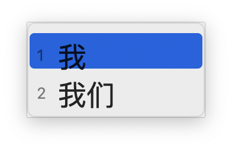
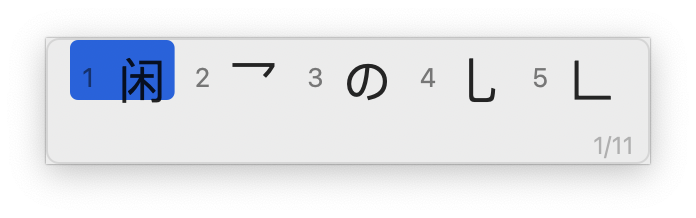
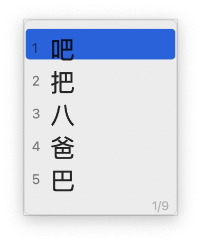

# 虎爪 for macOS（InputMethodKit）

把 TigerClaw 的 **虎码字词 / 虎整句** 输入引擎接到 macOS 的原生输入法框架
InputMethodKit。Windows 的 TSF 前端、命名管道 Core、Overlay/Dialog 进程都没有
参与；这里由 `IMKInputController` 直接持有 TigerClaw 的
`RuntimeLexicons` + `RuntimeInput`（同一套 C++ 词库、组句、五 gram 和键位逻辑）。

当前版本 **0.1.0**，Bundle ID `com.viui.inputmethod.TigerClaw`，
输入源显示名 **虎爪**。



## 已实现

- **虎码字词**：编码、候选、空格/数字/`;`/`'` 选重、`-` `=` 与 ↑ ↓ 翻页、
  鼠标点选、四码无重自动上屏、退格/Esc/Enter/Tab、中文标点；
- **虎整句**：连续编码实时组句，候选随输入更新；↑ ↓ 选择整句候选，
  空格确认；长候选自动分页；
- **方案切换**：输入法菜单 → 虎爪 → 虎码字词 / 虎整句；选择写入
  `~/Library/Application Support/TigerClaw/config.txt`；
- **候选窗**：跟随插入点，越界翻到光标上方；纵向/横向布局跟随
  `候选布局`（1/3 横向，2/4 纵向）；显示序号、页码、鼠标点选；
- **拼音反查**：`` ` `` 进入拼音反查（需要 `拼音反查码表`，随包提供）；
- **中英切换**：Shift / Ctrl+Space（使用引擎原有配置）；
- **加词**：Ctrl+= 打开加词窗口，写入当前方案的 `用户调整.txt`；
- 用户配置、词库调整、自学习目录均在
  `~/Library/Application Support/TigerClaw/`，升级 App 不会覆盖。

| 纵向 | 横向 | 拼音反查 |
| --- | --- | --- |
|  |  |  |

## 构建

要求：macOS 13+、Xcode Command Line Tools / Xcode 16、CMake 3.25+。

整句模型 `sentence-fivegram-mobile.bin` 有 **405 MB**，不放进 Git 仓库。
用环境变量指向它（SHA256 应为
`756f6c92cf43ad6e8e3087ce66b711ac6ad0fc41e6f3fb82b3766e35ecab8681`）：

```sh
export TIGERCLAW_SENTENCE_MODEL=/path/to/sentence-fivegram-mobile.bin
macos/build.sh
```

不提供模型也能构建，此时只有 `虎码字词`，`虎整句` 会退回普通码表；
`ctest` 会跳过整句断言并仍然通过。

构建产物：`macos/build/TigerClaw.app`，并在资源就位后做 ad-hoc 签名。
引擎验收探针 `macos/build/tigerclaw_engine_probe` 与 App 使用同一条
`RuntimeInput` 路径。

## 安装

```sh
macos/install.sh              # 当前用户（写 ~/Library/Input Methods）
sudo macos/install.sh         # 系统级（写 /Library/Input Methods）
```

安装脚本会：

1. 停掉旧进程；
2. `ditto` 安装 App；
3. 在资源完整后 `codesign --force --deep --sign -`；
4. `lsregister -u` 清掉指向 `build/` 的旧记录，再登记安装副本；
5. `--register-input-source`，并尽量 `--enable-input-source --select`。

如果 `--enable-input-source` 返回失败（常见于新装后 TextInputServices 还没
刷新），到 **系统设置 → 键盘 → 输入法** 里手动添加“虎爪”，或注销重登一次。

制作系统安装包：

```sh
macos/build-pkg.sh
# 输出 build/TigerClaw-macOS-0.1.0.pkg
sudo installer -pkg build/TigerClaw-macOS-0.1.0.pkg -target /
```

安装包是 ad-hoc 签名，Installer 不会显示“自动注销”按钮；装完注销/重登最稳。

卸载：

```sh
macos/uninstall.sh            # 当前用户
sudo macos/uninstall.sh       # 连系统级副本
```

## 运行时数据

```
~/Library/Application Support/TigerClaw/
  config.txt                 # 首次运行由 ConfigDefaults 生成
  码表/
    虎码字词/                # tigress*.dict.yaml、注释、拆分、常用符号、快符
    虎整句/                  # 虎整句.txt、补充语料.txt、注释/拆分
  拼音反查码表/拼音.txt
  自定义选重键.txt           # 可选，由引擎读取
  码表导出/                  # 导出功能尚未接入界面
```

首次运行会把 App 包内的 `Resources/码表`、`Resources/拼音反查码表` 复制到
上述目录；之后修改码表/加词/学习日志都写在这里，不会改 App 包。

模型直接从 App 包内 mmap：`Resources/Models/sentence-fivegram-mobile.bin`。
词库与模型按方案缓存；切到 `虎整句` 才会映射模型。

## 目录

| 文件 | 职责 |
| --- | --- |
| `TigerClawInputMethod.mm` | `IMKServer` 启动、注册/启用输入源 |
| `TigerClawInputController.mm` | 按键、marked text、上屏、菜单、方案切换、加词 |
| `TigerClawCandidateWindow.mm` | 非激活候选面板、纵向/横向布局、鼠标点选 |
| `TigerClawKeyMap.mm` | `NSEvent.keyCode` → Windows VK（完整 ANSI 表） |
| `TigerClawEngine.cpp/.hpp` | 引擎门面：路径、词库、配置、`RuntimeInput`、学习回执 |
| `engine_probe.cpp` | 无 GUI 验收：词库、字词候选、四码、整句、选择 |
| `compat/stop_token` | Apple libc++ 缺失的 C++20 stop-token 兼容层 |
| `resources/码表` | 虎码字词/虎整句数据（TigerClaw TXT/YAML 格式） |
| `pkg-scripts/` | 安装包前后脚本 |

引擎链路：

```
IMK handleEvent
  -> TigerClawEngine::Process
  -> tiger::core::RuntimeInput::Process
       -> ChineseInputSession / OrdinaryComposition   （字词）
       -> RuntimeSentenceState / RuntimeSentenceInput（整句五 gram）
  -> KeyPostProcessor（上屏文本/历史/重复/小数点）
  -> Snapshot（marked text、候选、页码）
  -> NSTextInputClient.setMarkedText / insertText
```

## 验收

```sh
macos/build.sh
ctest --test-dir macos/build --output-on-failure
```

`tigerclaw_engine` 覆盖：

- 首次运行把内置码表复制到可写目录；
- `U` → 候选 `的 / 工作`，空格上屏 `的`；
- `F` → 候选 `一 / 开始`；
- 切到 `虎整句` 后 `T` 的整句候选 `我 / 我们`，鼠标/索引选择上屏；
- 模型缺失时跳过整句断言。

手工回归（见 `PORTING.md` 的“实测记录”）：

- 四码无重自动上屏：`tuja` → `我们`；
- 数字/分号/空格/鼠标选重、`-` `=` 与 ↑↓ 翻页、页码；
- 退格、Esc、Enter 上屏原码、Tab 清屏；
- 标点 `,` `.` → `，` `。`；
- Shift 中英切换、拼音反查 `` `ba `` → 吧/把/八/爸/巴；
- 候选窗跟随光标、纵向/横向布局、加词写入 `用户调整.txt`。

## 已知限制

- **未移植**：完整设置窗口、皮肤、状态栏/Overlay、TSF/Hook 前端、导出词库界面、
  全拼方案（`虎爪全拼` 需要 Wanxiang 词库和 KenLM，不在本仓库资源内）。
- **整句自学习**：引擎与回执链路已接好；普通空格确认没有产生可持久化事件，
  Tab 自学习尚未做端到端验收（详见 `PORTING.md`）。
- 405 MB 模型不随源码分发；不设置模型时只有字词方案。
- 安装包为 ad-hoc 签名；系统级安装需要管理员；首次启用可能需要注销重登。
- 候选窗几何依赖客户端实现：优先 `firstRectForCharacterRange`，再
  `attributesForCharacterIndex:lineHeightRectangle:`，最后鼠标位置；
  WebView 不返回几何时只能落在鼠标附近。
- 与 Windows 版共享**同一套引擎源码与码表格式**，但 UI/设置项不是逐项复刻；
  例如候选布局的 5 号“仅编码”模式尚未做专门绘制。

## 排障

| 症状 | 处理 |
| --- | --- |
| 输入源列表里没有虎爪 | 确认安装目录、`--register-input-source`，注销重登 |
| 列表里有但灰色 | `lsregister -u <旧路径>` 后重新登记安装副本 |
| 选中无反应 | 看 `log show --last 5m --predicate 'process == "TigerClaw"'` |
| 候选窗不出现 | 确认 App 未被 Gatekeeper 拦截；面板需 `hidesOnDeactivate=NO` |
| 方向键后编码消失 | 只实现了 `handleEvent:`，不要再加 `inputText:` |
| 分号/引号选重无效 | 标点必须映射到 VK 186/222，不能传 ASCII |
| 字母错位 | ANSI keyCode 表缺项会整体错位，保持完整 0..49 表 |
| 装进 `.localized/` | 安装包 `preinstall` 删除同名/同 ID 旧副本 |
| 首次按键被吞 | 输入法进程按需启动；预先启动/登录项可缓解 |

## 数据来源

- 引擎、协议、码表格式：`https://github.com/viui798/tigerclaw`（GPL-3.0-only）；
- 虎码字词/虎整句、拼音反查、五 gram 模型：工作区参考实现
  `/Users/viui/Desktop/Tigirl macOS/` 下的 `resources/DefaultData` 与
  `build-macos/.../Resources/Models`；
- 词库格式与 TigerClaw 的 `LexiconLineParser` 完全兼容（`.txt` 与
  `.dict.yaml` 均可），模型 SHA256 与 TigerClaw 主线一致。

本项目沿用 TigerClaw 的 GPL-3.0-only。
